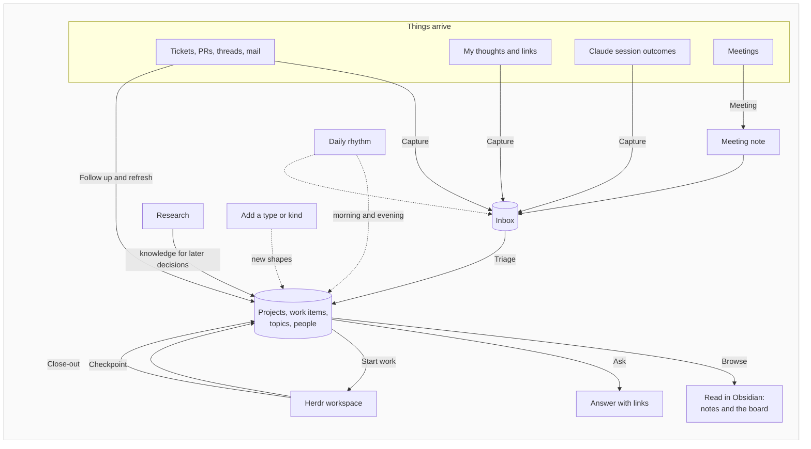

# Vision

Status: **current direction, still exploring** (2026-10-11). Nothing here is final.

It replaces the vision behind kiln 0.1, an engine removed in 0.2 ([ADR 0001](../adr/0001-remove-the-v0-1-engine.md)).

## Problem

Work has been done ad hoc, so nothing accumulates in one place. A knowledge vault exists but Claude cannot readily reach it from where work happens, so knowledge neither goes in nor comes out. Runs, investigations and decisions leave no trace once a session ends.

## What kiln is

kiln is **my process for knowledge and work, built on Obsidian**: a vault structure that reads well, the workflows that keep it current, and Claude skills that follow the same process.

Obsidian first. Then Claude. Then everything else.

## Principles

- **P1 Written for a reader.** Every note is shaped for a person reading it in Obsidian. Fields that exist for search or tooling must not hurt readability.
- **P2 Obsidian is home.** Structure, views and workflows are designed in Obsidian. Claude follows the same structure rather than having its own.
- **P3 Plain files, reachable from anywhere.** The vault is markdown on disk, and any Claude session in any folder can reach it. Obsidian is needed only for what it does better, through its CLI ([ADR 0002](../adr/0002-claude-reaches-the-vault-through-files-and-the-obsidian-cli.md)).
- **P4 My process, not a generic one.** Reuse Obsidian's core features and community plugins where they fit the process. Build kiln's own where the process needs it.
- **P5 Configuration first, code when it earns its place.** Start as a vault blueprint: types and kinds, templates, Bases views, CSS snippets and a few community plugins. Grow a kiln Obsidian plugin as gaps appear. Custom views (inbox, project, board) and icon and styling rules are the expected first gaps.
- **P6 Easy to extend.** Adding a type or kind is cheap for me and for Claude, and it arrives with its template, icon, styling and views.
- **P7 One inbox.** Everything comes in one way and is triaged in one place.
- **P8 Remote truth, selective local context.** External systems own their data. Only what I engage with is held locally, as a summary. Writes out are explicit and approved.

## Flows

A flow is one journey through kiln, from a trigger to a result. Each flow's design lives in [its epic on GitHub](https://github.com/Kieranties/kiln/issues?q=is%3Aissue%20label%3Aepic) until the flow is built; then it gets a guide. The order they are built in is the order of the [kiln project board](https://github.com/users/Kieranties/projects/5).

The flows' diagrams use these lanes:

| Lane | What it is |
|---|---|
| **Me** | The owner |
| **Obsidian** | The vault on screen: notes, embedded Bases views, the daily note |
| **Claude** | Claudian inside Obsidian, or a Claude session in a Herdr tab. Same skills either way |
| **Herdr** | Workspaces: tabs, Claude sessions, worktrees |
| **Vault** | The markdown files on disk, with kiln's templates, views and checks |
| **External** | Jira, GitHub, Slack, mail, calendar, meeting notes, the web |

How the flows hand off to each other:



## Entities, types and kinds

Everything in the vault is an **entity**: one note about one thing. Every entity has a **type**, and may have a **kind** within that type:

- **Type** is the top level: `work`, `organisation`, `reference`, `person`.
- **Kind** narrows a type: work is a `bug` or a `feature`, an organisation is a `client` or a `vendor`.

The type decides the template, properties, icon, styling and views. A kind can override any of them, such as a bug icon on bug work items. Views filter on either level. Types and kinds are cheap to add (P6). The starting set is in the blueprint: [How notes are shaped](./notes.md).

Types differ in how long their entities live:

| Lifespan | Example types |
|---|---|
| **Persists** | organisation, product, topic, person |
| **Ends** | project, work |
| **A moment** | meeting, daily, decision |

Persisting is a trait of a type, not a separate tier.

## Work model

```
Persisting entities  <-  Project  <-  Work item  <-  Workspace  <-  Worktree
(product, topic,         (finite,     (the what)     (the where,    (one repo
 person, ...)             optional)                   ephemeral)     checkout)
```

- **If it ends, it is a project. If it persists, it is a persisting type.** The Fan App is a product. Fan App v1 and v2 are projects that distil onto it.
- **The ticket is the team's record; the work item is mine.**
- **Workspaces and worktrees are where work runs** (Herdr, git). They are not entities; the work item records them.
- **Work distils upward when it closes:** worktree, then workspace, then work item, then project, then onto the persisting entities.

## Search

- **Me:** Obsidian's search, the quick switcher (which matches aliases) and Bases views.
- **Claude:** reading the files, and the Obsidian CLI for search, backlinks and Bases queries, guided by skills that know the vault's structure.

Readable `summary`, `aliases` and `keywords` properties help both. Dedicated search is revisited only when real use shows misses.
