# kiln user flows

Status: **draft, exploring** (2026-10-11). Nothing here is final.

## Why this document exists

KB core v1 built an engine before the experience, and its notes were shaped for Claude rather than for a person. The [revised vision](../vision.md) puts Obsidian first, then Claude, then everything else:

- **Obsidian is where knowledge is read and browsed.** It is the main surface.
- **Claudian** (Claude in an Obsidian side panel) is how Claude is reached while reading.
- **Herdr** is where work runs: a workspace per batch of work, Claude sessions and worktrees in its tabs.

This document draws the flows from the user's side ("I do X, I see Y"), and ends with the agreed story order.

Every diagram sets a light theme and a light panel, so it reads the same in a dark or light viewer.

## Lanes

| Lane | What it is |
|---|---|
| **Me** | The owner |
| **Obsidian** | The vault on screen: notes, embedded Bases views, the daily note |
| **Claude** | Claudian inside Obsidian, or a Claude session in a Herdr tab. Same skills either way |
| **Herdr** | Workspaces: tabs, Claude sessions, worktrees |
| **Vault** | The markdown files on disk, with kiln's templates, views and checks |
| **External** | Jira, GitHub, Slack, mail, calendar, meeting notes, the web |

## Map

How the flows hand off to each other. Numbers match the sections below.

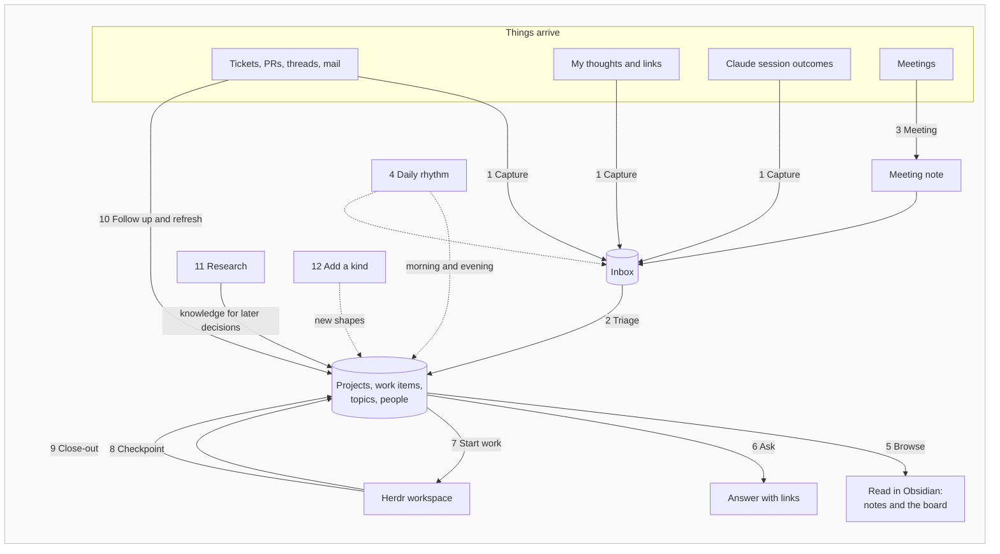

## 1. Capture

**Trigger:** something turns up anywhere. **Result:** it is in one inbox, and I trust it will be dealt with. "Single process to input, launch from anywhere."

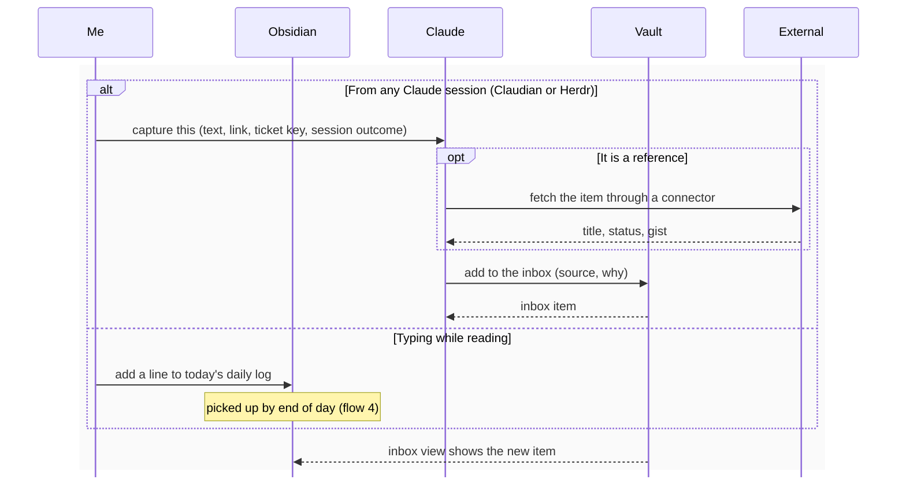

Open questions:

- Is the daily note's log a capture surface, as it was in the previous vault?
- Do captured sources live in the visible tree, or somewhere out of sight with only the inbox view showing them?
- Should capture offer to file straight away when the target is obvious, or always go through triage?

## 2. Triage

**Trigger:** the inbox has items, or end of day. **Result:** every item is filed to a note I can find, or dismissed.

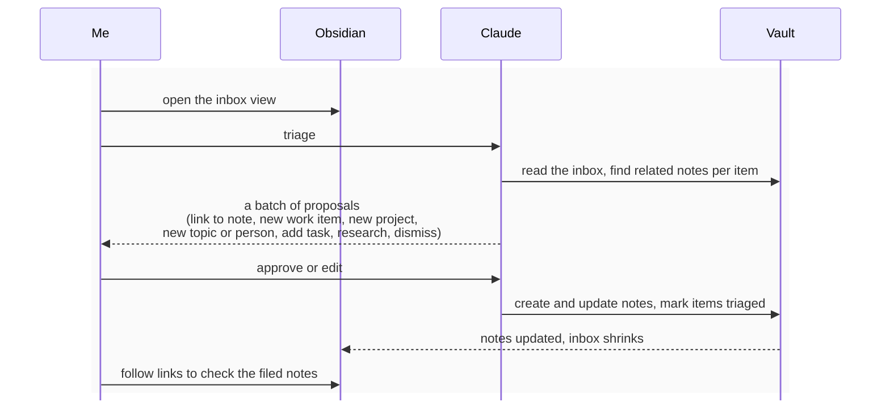

Open questions:

- Triage can create anything, including a new topic, person or project.
- Where does a task go? The previous vault had a board per project for personal tasks.
- Is "review needed" still a flag, or does triage simply ask when it is unsure?

## 3. Meeting

**Trigger:** a meeting happens. **Result:** a meeting note linked to its people and project, with actions and decisions filed.

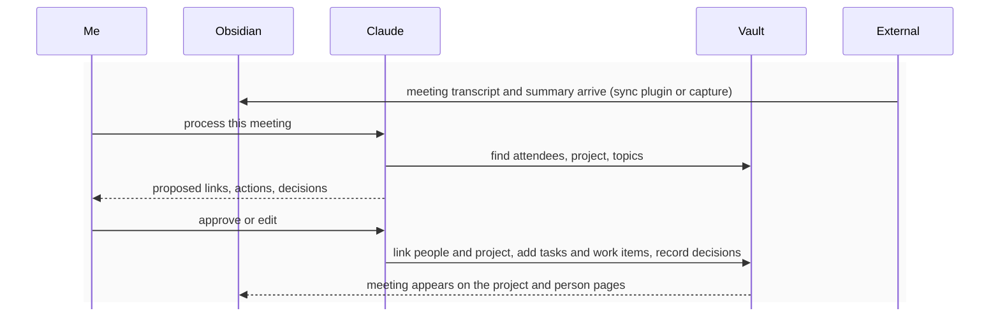

Open questions:

- Is a meeting note a source (machine-owned) or mine to annotate? Probably both: synced content plus my section.
- Keep the meeting sync plugin writing into the vault, or capture meetings by reference?

## 4. Daily rhythm

**Trigger:** start and end of the working day. **Result:** in the morning I know what is on and what changed. Through the day the daily note is a running log, written by me and by Claude. In the evening nothing is left loose and I know where I stopped.

Agreed:

- **The daily note is a log, not a task list.** Copying task lists forward each morning was not useful. Status lives on the board (flow 5), across all projects or one.
- **Both of us write to it.** I add lines as I go. Claude sessions (Claudian or Herdr) add lines too: started X, PR opened, decided Y.
- **It is frozen once the day is over,** by convention rather than enforcement. Claude and I simply don't write to a past daily note. It stays as the record of that day.

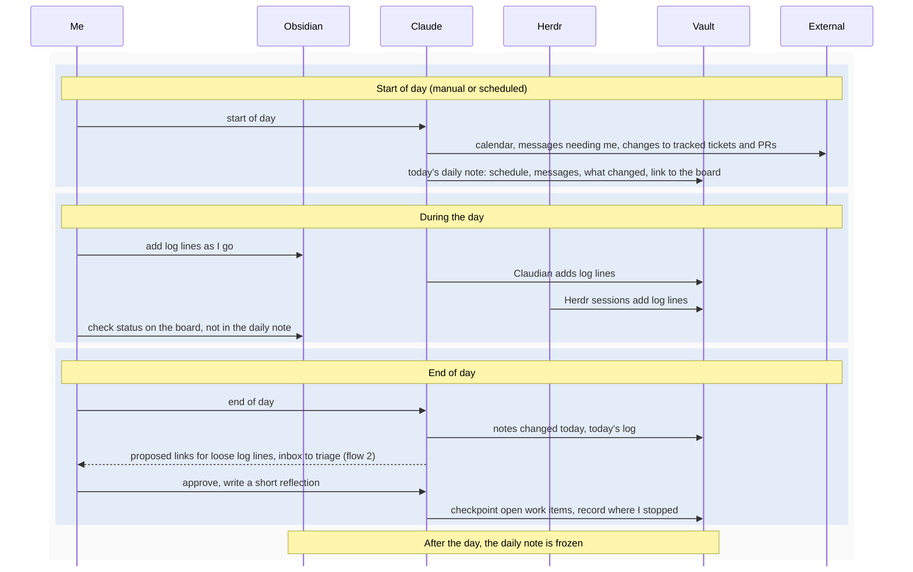

Open questions:

- What earns a log line from Claude, so the log stays readable?
- Is Resume simply start of day, or also "resume this work item" from its note?

## 5. Browse

**Trigger:** I open a project, work item, topic or person in Obsidian, or the board. **Result:** the page tells me the current state and shows everything related, without asking Claude. The board shows status across projects.

Current direction: the board is a kanban view over a Base (the previous vault used the Kanban Bases View community plugin), not kiln code.

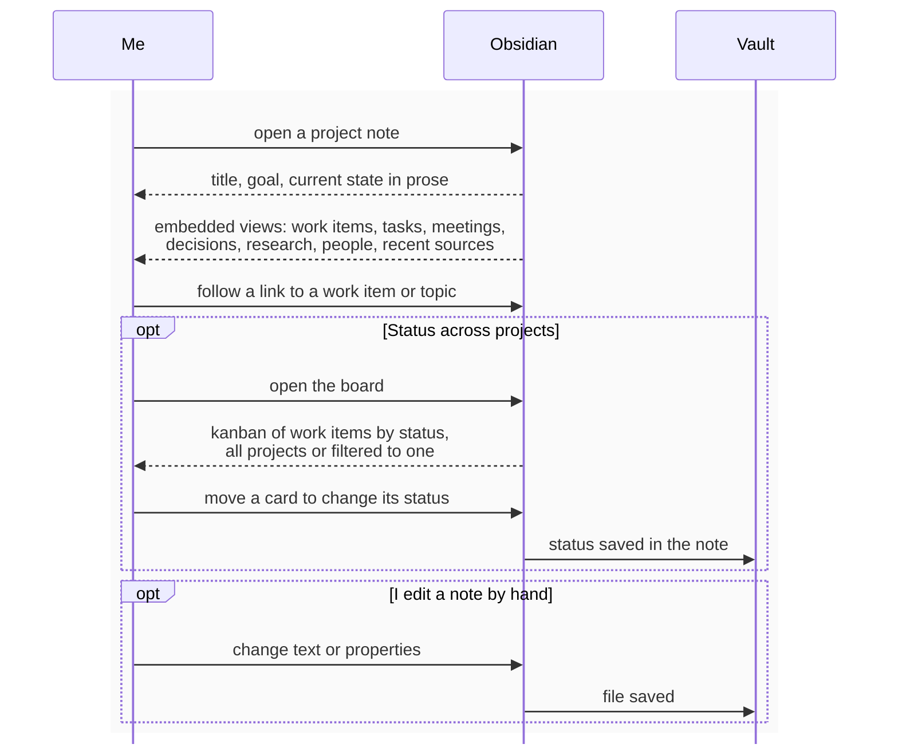

Open questions:

- What must each kind show at a glance? (This becomes the note-shape work.)
- Hand edits are normal. What checks a note's shape after I edit it?
- Is there a home note: what is active, inbox count, today?
- What are the board's columns, and are personal tasks cards alongside work items?

## 6. Ask

**Trigger:** a question while reading or working. **Result:** an answer with links I can click into Obsidian.

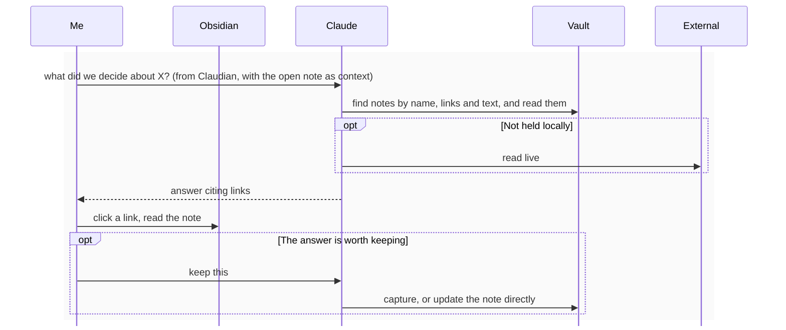

Agreed: Claudian passes the open note as context, so a question asked while reading starts from that note.

## 7. Start work

**Trigger:** I decide to work on something. **Result:** a Herdr workspace where Claude already holds the context, with the right worktrees, and the work item knows where its work is running.

Agreed: work can also start outside Obsidian, from any terminal or Herdr tab in any folder. Claude must still find the vault from there.

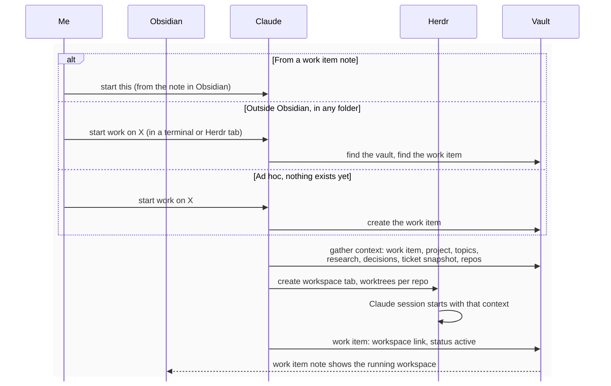

Open questions:

- Who launches Herdr from Obsidian: Claudian calling the Herdr CLI, or an Obsidian command?
- One workspace can hold several work items ("a batch of work: a ticket and sub-tasks, or an ad hoc change across repos"). How is that chosen at start?
- Where do the repos come from: links on the project or work item?

## 8. Work and checkpoint

**Trigger:** progress inside a workspace. **Result:** the work item always says where things stand, even if the workspace is abandoned.

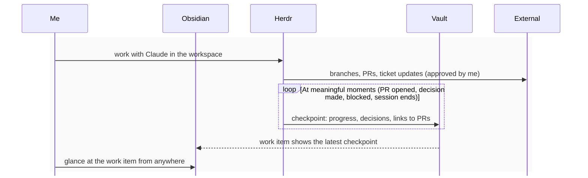

Open questions:

- Automatic (hook on session end or compaction) or explicit? How to avoid noise?
- Decisions made in a workspace: on the work item, the project, or both?

## 9. Close-out

**Trigger:** a piece of work finishes, found by me or by a scheduled sweep. **Result:** knowledge flows up, and the project and topic notes stay current.

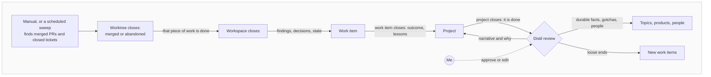

Open questions:

- Does each step propose a review list, or only the project close?
- Does a work item mirror its ticket's status, and close when the ticket closes?
- Does a scheduled run only queue proposals for me, or apply the safe ones?

## 10. Follow up and refresh

**Trigger:** something external changes, or I need to act outwards. Refresh runs on touch, on a schedule, or when I ask. **Result:** my notes show the current state, and nothing goes out without my approval.

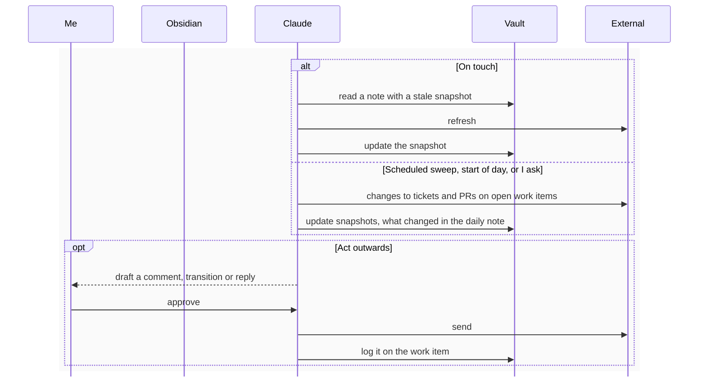

Open questions:

- What runs the schedule: a Claude scheduled task, Windows Task Scheduler with `claude -p`, or n8n?
- Are background feeders (n8n) still wanted for capture, or is a scheduled sweep enough for now?

## 11. Research

**Trigger:** a question I will need answered before a decision, or an investigation that needs grounding. **Result:** durable knowledge in the vault, written to outlive the work that prompted it, that later decisions cite.

Two shapes, both from the previous vault:

- **Topic knowledge:** how something works in the world, such as a vendor API, a protocol or a product. A topic hub with focused notes that each answer one question (payloads, handling contract, lifecycle, operations), and a reference note per source read. Not tied to one client or integration.
- **Current-state research:** a question about our own systems, checked against that topic knowledge ("where does our integration diverge from the documented contract, and what is the blast radius?"). A research note with the question and findings. It records and does not fix: each finding becomes a work item.

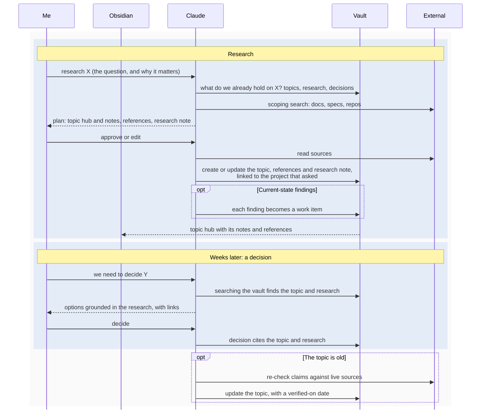

Open questions:

- Topic hubs split into notes by question, as in the previous vault, or one long note?
- A reference note per source, or a source list on the topic?
- Does a topic carry a verified-on date, and does start of day flag stale ones?
- Long research as its own Herdr workspace, or inline in Claudian?

## 12. Add a kind

**Trigger:** I need a kind of note that does not exist yet (a runbook, an RFC, a vendor), or Claude notices notes that keep taking the same shape. **Result:** the new kind has a template, its own icon and styling, views, and the rest of the process knows it: Claude's skills, triage and the checks.

v1 fixed its types in code. The previous vault made new kinds easy but nothing checked them. This flow wants both: easy to add, and fully hooked in.

Agreed: every note is an entity of one kind. See [entities and kinds](../vision.md#entities-and-kinds).

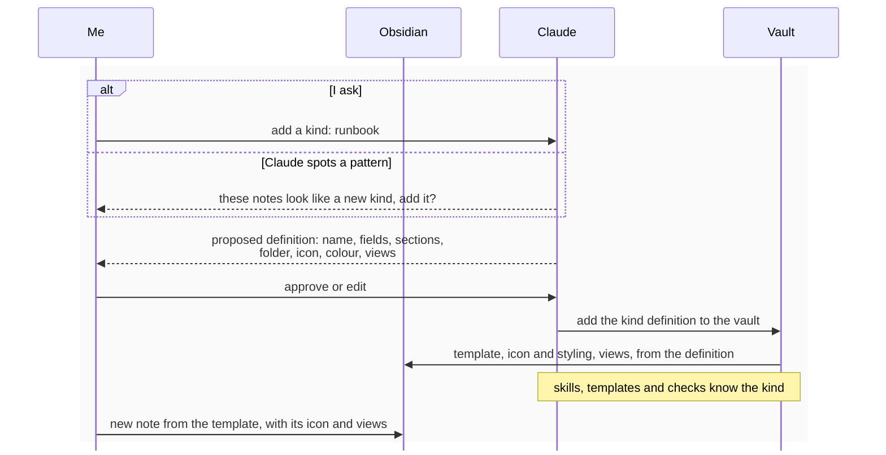

Open questions:

- Where does a kind definition live? Probably in the vault itself, as a note I can read and edit in Obsidian.
- How are icons and styling applied: an icon plugin, a CSS snippet keyed on the kind property, or both?
- What does "hooked in" include: template, views, triage outcome, which fields are hidden, check rules?
- At layer 1 this is configuration (a definition plus generated template, CSS and views). A kiln plugin takes it over later.

## Story order

Agreed 2026-10-11. Each step makes something usable in Obsidian.

| Step | Flows | Delivers |
|---|---|---|
| 1 | Note shapes, Add a kind (12), Browse (5) | Notes that read well, kinds that are easy to add, the board |
| 1a | Migration slice | One real project with its topics, people and meetings, moved by hand into the new shapes to test them on real content |
| 2 | Capture (1), Triage (2) | Reshaped to write the new shapes, including new topics, people and projects |
| 3 | Research (11) | Knowledge brought in for later decisions |
| 4 | Ask (6) | From Claudian, starting from the open note |
| 5 | Daily rhythm (4), Meeting (3) | The daily log written by both of us, frozen after its day |
| 6 | Start work (7), Work and checkpoint (8) | Herdr workspaces, from Obsidian or any folder |
| 7 | Close-out (9), Follow up and refresh (10) | Scheduled or manual |
| 8 | Migration | The rest of the previous vault |

## Not drawn yet

- **Hand-over and export:** bundle a project or topic into a zip or PDF to share (the previous vault's `dump`).
- **Projects:** shaping a new project, and its lifecycle (shaping, active, closing, closed).
- **Multiple bases:** work and personal, and which base a session uses.
