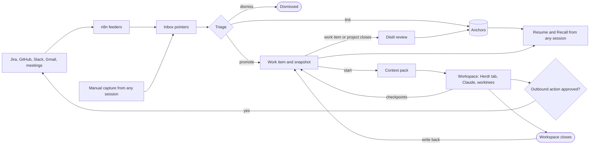

# kiln vision

Status: **current direction, still exploring** (2026-10-10). Nothing here is final. This document is the written record.

## Problem

Work has been done ad hoc, so nothing accumulates in one place. A knowledge vault exists but Claude cannot readily reach it from where work happens, so knowledge neither goes in nor comes out. Runs, investigations and decisions leave no trace once a session ends.

## Core jobs

| Job | Question it answers |
|---|---|
| **Capture** | Throw anything in from anywhere and trust it lands somewhere findable |
| **Resume** | What am I working on, what state is it in, where did I stop? |
| **Start** | Kick off work with Claude already holding the relevant notes, decisions, people and repos |
| **Recall** | What do I know, or what did we decide, about X, with links to sources? |

Sources: trackers (Jira, GitHub), conversations (Slack, Gmail), meetings (transcripts, calendar), ad hoc (thoughts, links, research, Claude session outcomes).

## Principles

- **P1 Reachable from any session.** Knowledge is reachable from any Claude session in any repo or worktree, without opening a separate place first. Obsidian is a viewer, not the gate.
- **P2 One inbox, many feeders.** Watchers and manual capture all land in one inbox. One triage step files them, whatever the source.
- **P3 Clean slate.** The previous vault, skills and convoy are prior art to learn from, not foundations.
- **P4 Personal, local-first.** Knowledge stays private and local. Contributions to repos are deliberate and occasional.
- **P5 Remote truth, selective local context.** External systems own their data. Only what you engage with is held locally, as a summary; everything else is read live. Writes out are explicit and approved.

## Work model

```
Anchors  <-  Project  <-  Work item  <-  Workspace  <-  Worktree
(durable)    (finite,     (the what)     (the where,    (one repo
              optional)                   ephemeral)     checkout)
```

- **Anchor**: something that persists. Clients, products, services and repos, people, topics. Anchors hold *current truth* and never close (they may be archived).
- **Project**: a named, finite outcome. It has a goal and definition of done, a scope expressed as links (any number of clients, repos, people), a lifecycle (shaping, active, closing, closed) and its own focused knowledge. Projects hold *history*. Optional.
- **Work item**: your notebook for a piece of work. When a ticket exists it is a thin wrapper: it links the ticket, mirrors its status and never copies its content. When no ticket exists it is the only record. Work items are created lazily, when you start, not when a ticket is ingested.
- **Workspace**: an ephemeral execution container for one or more work items: repos, worktrees, a Herdr tab, live context.
- **Worktree**: one repo checkout inside a workspace.

Rules of thumb:

- **If it ends, it is a project. If it persists, it is an anchor.** LFC All Reds is an anchor (a product); All Reds v1 and v2 are projects that distil onto it. The anchor lists its projects by query, which gives the programme view without a programme level.
- **The ticket is the team's record; the work item is yours.**

### Close-out and distillation

Each level distils upward when it closes:

1. Worktree closes: merged or abandoned.
2. Workspace closes: findings, decisions and state are written back to its work items.
3. Work item closes: outcome and lessons recorded; its project is updated.
4. Project closes: durable knowledge is promoted onto anchors.

Workspaces also **checkpoint into the work item continuously**, so Resume works even if a workspace is abandoned.

| Kind of knowledge | Goes to | Example |
|---|---|---|
| Durable fact or decision | Promoted to the anchor, with a link back to the source | Subscriptions lifecycle is a state machine (decided in Subs v2) |
| Gotcha, runbook, how-to | The anchor it applies to | .NET 10: Aspire host needs X, on each affected repo |
| People and ownership | Person and client anchors | Chris owns the orders inbox pattern |
| Loose ends | New work items, or Known issues on the anchor | Webhook retry not idempotent becomes a bug |
| Narrative and why | Stays on the project, searchable | Pivoted from polling to webhooks in week 3 |
| Scratch | Dropped or archived | Run logs, plan drafts |

Claude proposes each distillation as a review list; you approve or edit it. Anchors stay short: when a later project changes a fact, the anchor is rewritten and the old version survives through the link to its source.

## Sources and sync

Two layers:

- **Sources layer (machine-owned)**: pointers and summary snapshots of external things. Written only by feeders and capture, never hand-edited. An unlinked source item *is* an inbox item.
- **Knowledge layer (yours)**: anchors, projects, work items. Links to sources, never copies them.

How local is it?

| Tier | What | Local footprint |
|---|---|---|
| **Live** | Anything not engaged with | Nothing. Claude reads it via MCP on demand |
| **Pointer** | Flagged as maybe relevant | One inbox line: key, title, link, why it surfaced |
| **Snapshot** | Linked from a work item or project | A summary (title, status, assignee, gist, key comments, links) with `refreshed_at` |

Triage moves items between tiers: a pointer is dismissed, linked, or promoted (which creates a snapshot).

Refresh:

1. **On touch** (primary): Claude refreshes a stale snapshot before using it. Correctness does not depend on a background process.
2. **Sweep**: a scheduled job refreshes snapshots of open work items only, so Resume can show what changed.
3. **Freeze**: the final snapshot is taken when the work item closes.

Writes out (comment on a ticket, transition it, reply to a thread) are explicit outbound actions: Claude drafts, you approve, the work item logs it, the next refresh mirrors it back. Conflicts cannot occur: mirrors are always overwritten from the source and your notes are never pushed automatically.

## Architecture

```
 Claude Code      Obsidian cockpit     n8n feeders      Herdr
 (skills)         (Bases + plugin)     (intake)         (workspaces)
     |  MCP            |  HTTP             |  HTTP          |  CLI
     +-----------------+-------------------+----------------+
                               |
                    Local KB server (MCP + HTTP)
     search, get_anchor, get_work_item, capture, link, resume,
     context_pack, distil, outbound actions, snapshot sweep
                               |
           +-------------------+--------------------+
     Markdown (the truth)                 Derived index (cache)
     sources layer + knowledge layer      SQLite full text, embeddings later
```

- **Markdown is the truth.** Plain files, viewable and editable in Obsidian.
- **The KB server is the engine.** Headless and always available. It owns the schema, placement and links, so every write is correct regardless of client. Registered at user scope so it is present in every Claude session. The index is rebuildable from the Markdown.
- **Skills** sit on top for judgement-heavy workflows: triage, distil, start.
- **n8n** handles intake from external systems (integrations, credentials, schedules, per-source flags) and posts pointers to the server. The server itself runs the snapshot sweep.
- **Obsidian is the cockpit, never required.** Bases views over frontmatter, plus a custom plugin on the same server API: inbox triage, resume dashboard, start workspace, approvals queue, distil review.
- Rejected: Obsidian as the engine (CLI or Local REST API). It needs the desktop app running, which makes it the gate again and breaks P1.

Retrieval order: anchors (current truth), then links (projects, work items, decisions), then full-text search, then live MCP reads of external systems. **Start** is `context_pack(work item)`: the relevant anchor summaries, the work item, its snapshots and recent decisions, assembled into the workspace as it opens.

## End-to-end flow



## Sub-projects

Built in this order, each with its own spec, plan and implementation:

| Order | Sub-project | Delivers |
|---|---|---|
| 1 | **KB core**: folder layout, schema, KB server (MCP + HTTP), index, base skills (capture, triage, recall, resume) | Manual capture, Recall, Resume from any session |
| 2 | **Feeders**: n8n flows for Jira, GitHub, Slack, Gmail, meetings; snapshot sweep | Automatic capture |
| 3 | **Workspace lifecycle**: context pack, start (Herdr, worktrees), checkpoints, close and write back, distil, outbound actions | Start with context; the close-out path |
| 4 | **Obsidian cockpit**: Bases views, then the custom plugin | Review and approval UI |
| 5 | **Migration**: map the previous vault into anchors, projects and work items; archive the rest | Historical knowledge |
